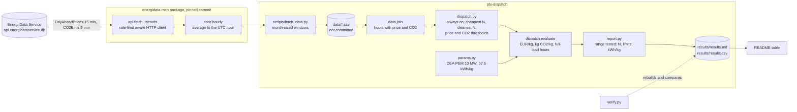

# Architecture

How a results row is made, from the open API to the table in the README.

- `src/ptx_dispatch/dispatch.py` holds only pure functions, so the unit tests in
  `tests/test_dispatch.py` run on an 8-hour hand-checked series without network.
- `scripts/reproduce.py` runs fetch then analysis; `verify.py` rebuilds the table from
  `data/` and fails if it differs from the committed `results/results.md`.
